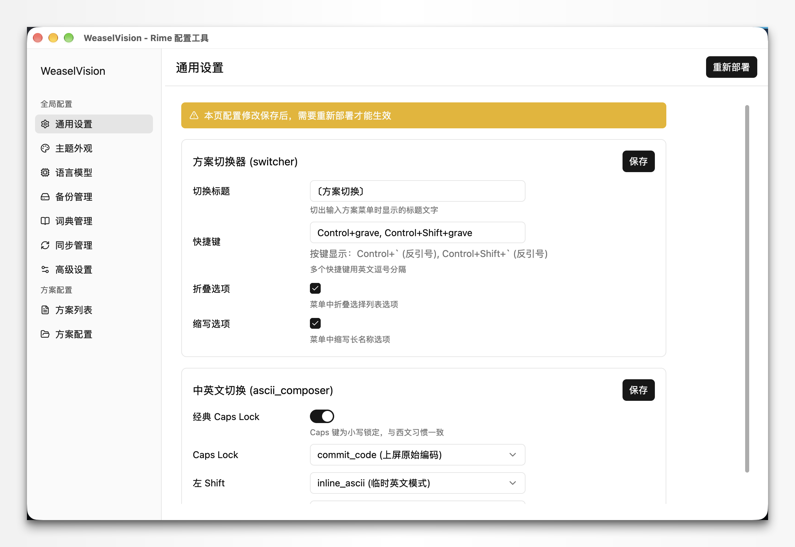

# RimeVision

Rime 输入法可视化配置工具。当前版本 **WeaselVision** 已迁移为 GPUI Rust 原生 UI（v0.5.0 起），此前的 Tauri + Vue 版与 Swift 版均已移除。

## 平台支持

| 平台 | 架构 | 文件 |
|------|------|------|
| macOS | Apple Silicon (arm64) | `WeaselVision_0.5.0_arm64.dmg` |
| macOS | Intel (x64) | `WeaselVision_0.5.0_x64.dmg` |
| Windows | ARM64 | `WeaselVision_0.5.0_Windows_arm64.zip` |
| Windows | x64 | `WeaselVision_0.5.0_Windows_x64.zip` |

## 安装与使用

### 从 Release 下载（推荐）

前往 [GitHub Releases](https://github.com/franvz9/Rime_vision/releases) 下载对应平台的安装包。

#### macOS 安装

下载 `.dmg` 后，由于应用未经过 Apple 官方签名，首次打开前需要移除隔离标记：

```bash
sudo xattr -rd com.apple.quarantine /Applications/WeaselVision.app
```

然后双击 `WeaselVision.app` 即可运行。

#### Windows 安装

解压 `WeaselVision_0.5.0_Windows_<架构>.zip`，直接运行其中的 `weasel-gpui.exe`（便携版，无需安装）。

## 截图



### 从源码构建

```bash
cd weasel_vision
cargo run -p weasel-gpui          # 开发模式（debug）
cargo build --release -p weasel-gpui   # 生产构建
```

> 项目使用 `rust-toolchain.toml` 固定 Rust 1.100（GPUI 组件依赖），克隆后首次 cargo 命令会自动安装对应工具链。

## 功能

- ⚙️ **通用设置** — 方案切换器、中英文切换等全局系统行为
- 🎛️ **方案配置（Schema-Scoped）** — 按方案分别管理标点符号、快捷键、翻译器、候选词数，支持在「全局默认」与各方案间切换
- 🎨 **主题外观** — 可视化编辑 Rime 配色方案（亮色/暗色）和候选窗样式，实时预览
- 📝 **方案列表** — 两栏布局：列表 + 方案信息预览（名称/版本/作者/简介/依赖），支持切换「使用中」方案、导入方案
- 🧠 **语言模型** — 扫描、批量挂载/卸载（所见即所得）、导入 `.gram` 语言模型
- ⌨️ **快捷键** — 行摘要 + 弹窗编辑按键绑定（支持全局与方案级）
- 🔤 **标点符号** — 半角/全角标点规则编辑（支持全局与方案级）
- 💾 **备份管理** — 自动备份、创建/恢复/对比备份
- 📖 **词典管理** — 用户词典词条增删查改、词频编辑、快照生成/应用/导出
- 🔄 **同步管理** — Rime 同步目录配置与执行（支持网盘目录）
- 🔧 **高级设置** — 打开 Rime 目录、配置文件定位、一键重置
- 🚀 **一键部署** — 将配置写入 Rime 并通知输入法重新加载

## 技术栈

| 层 | 技术 |
|------|------|
| 桌面框架 | GPUI（Zed 同源）+ gpui-component |
| 逻辑库 | rime-core（纯 Rust，零 UI 依赖） |
| 配置格式 | YAML |

## 项目结构

```
Rime_vision/
└── weasel_vision/
    ├── crates/
    │   ├── rime-core/      # Rime 配置解析 + 业务逻辑（纯 Rust 库）
    │   └── weasel-gpui/    # GPUI 原生前端（13 个页面）
    ├── assets/icons/       # 应用图标
    └── rust-toolchain.toml # 固定 Rust 1.100
```

## License

MIT
