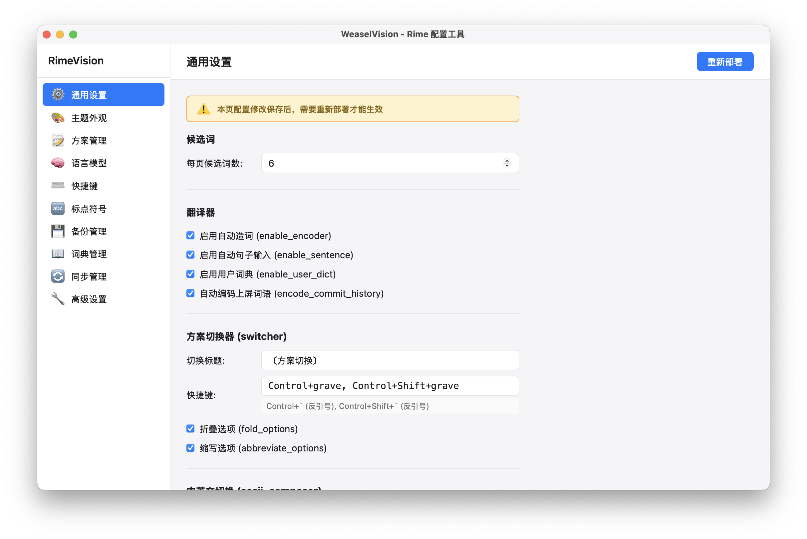

# RimeVision

Rime 输入法可视化配置工具。跨平台版 **WeaselVision** 当前为活跃维护版本，Swift 版 **RimeVision** 已归档。

## 平台支持

| 平台 | 架构 | 文件 |
|------|------|------|
| macOS | Apple Silicon (arm64) | `WeaselVision_0.4.0_arm64.dmg` |
| macOS | Intel (x64) | `WeaselVision_0.4.0_x64.dmg` |
| Windows | ARM64 | `WeaselVision_0.4.0_Windows_arm64.zip` |
| Windows | x64 | `WeaselVision_0.4.0_Windows_x64.zip` |

## 安装与使用

### 从 Release 下载（推荐）

前往 [GitHub Releases](https://github.com/franvz9/Rime_vision/releases) 下载对应平台的安装包。

#### macOS 安装

下载 `.dmg` 后，由于应用未经过 Apple 官方签名，首次打开前需要移除隔离标记：

```bash
sudo xattr -rd com.apple.quarantine /Applications/WeaselVision.app
```

然后双击 `WeaselVision.app` 即可运行。

#### Windows 安装

解压 `.zip`，双击 `WeaselVision.exe` 运行。

## 截图



### 从源码构建

```bash
cd weasel_vision
npm install
npm run tauri dev        # 开发模式
npm run tauri build      # 生产构建
```

## 功能

- ⚙️ **通用设置** — 方案切换器、中英文切换等全局系统行为
- 🎛️ **方案配置（Schema-Scoped）** — 按方案分别管理标点符号、快捷键、翻译器、候选词数，支持在「全局默认」与各方案间切换
- 🎨 **主题外观** — 可视化编辑 Rime 配色方案（亮色/暗色）和候选窗样式
- 📝 **方案列表** — 两栏布局：列表 + 方案信息预览（名称/版本/作者/简介/依赖），支持切换「使用中」方案、导入方案
- 🧠 **语言模型** — 扫描、挂载/卸载、导入 `.gram` 语言模型
- ⌨️ **快捷键** — 编辑按键绑定（支持全局与方案级）
- 🔤 **标点符号** — 半角/全角标点规则编辑（支持全局与方案级）
- 💾 **备份管理** — 自动备份、创建/恢复/对比备份
- 📖 **词典管理** — 用户词典词条增删查改、快照生成/应用/导出
- 🔄 **同步管理** — Rime 同步目录配置与执行
- 🔧 **高级设置** — 打开 Rime 目录、查看配置文件、一键重置
- 🚀 **一键部署** — 将配置写入 Rime 并通知输入法重新加载

## 技术栈

| 层 | 技术 |
|------|------|
| 桌面框架 | Tauri 2 |
| 前端 | Vue 3 + TypeScript + Vite |
| 后端 | Rust |
| 配置格式 | YAML |

## 项目结构

```
Rime_vision/
├── weasel_vision/          # 跨平台版（活跃维护）
│   ├── src/                # Vue 前端
│   │   ├── components/     # 页面组件
│   │   ├── composables/    # 组合式函数
│   │   └── utils.ts        # 工具函数
│   └── src-tauri/          # Rust 后端
│       └── src/
│           ├── commands/   # Tauri 命令层
│           └── rime/       # Rime 核心逻辑
└── archive/                # Swift 版（已归档）
    └── RimeVision/         # macOS 专用 Swift + SwiftUI 版
```

## Swift 版 RimeVision（归档）

`archive/RimeVision/` 是项目初始版本，使用 Swift 5.9 + SwiftUI 开发，仅支持 macOS。

归档原因：

1. 仅支持 macOS，无法覆盖 Windows 用户
2. 跨平台版 WeaselVision 已实现全部核心功能并新增备份管理、词典管理、同步管理等模块
3. 维护两套代码成本过高

如需从源码运行：

```bash
cd archive/RimeVision
swift run RimeVision
```

## License

MIT

